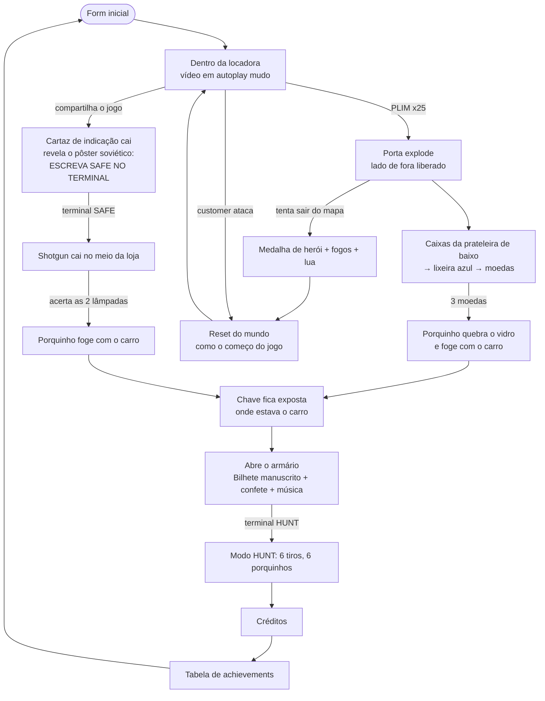

# Net Video Rental 2000 — Design da Fase Final

Documento vivo com tudo o que falta para **terminar o jogo**. Cada seção diz **o que existe hoje no código**, **o que muda** e **como saber que está pronto** (critérios de aceite). Os itens marcados com ❓ ainda precisam de decisão (veja a [§14](#14-perguntas-em-aberto)).

> Convenções do projeto continuam valendo (ver `CLAUDE.md`): sem build, ES modules, Three.js r128, estética PS1, modelos GLB passam por `fitModel` + `psxModel`/`matchStyle`, todo objeto que se move tem `userData.dynamic = true`, sons via Web Audio sintetizado, commits em Conventional Commits.

---

## Sumário

1. [Visão geral do fluxo](#1-visão-geral-do-fluxo)
2. [Estado global e reset do mundo](#2-estado-global-e-reset-do-mundo)
3. [Limpeza do HUD e segredos](#3-limpeza-do-hud-e-segredos)
4. [Quest do Porquinho (moedas)](#4-quest-do-porquinho-moedas)
5. [File "ZTA" (papel no chão)](#5-file-zta-papel-no-chão)
6. [Easter egg SAFE: a shotgun](#6-easter-egg-safe-a-shotgun)
7. [Terminal: HELP de uso único](#7-terminal-help-de-uso-único)
8. [Fuga do mapa: Medalha de Herói + Lua](#8-fuga-do-mapa-medalha-de-herói--lua)
9. [Cronograma do Customer](#9-cronograma-do-customer)
10. [Armário, cadeado e chave](#10-armário-cadeado-e-chave)
11. [Modo HUNT (final)](#11-modo-hunt-final)
12. [Sistema de Achievements](#12-sistema-de-achievements)
13. [Assets novos e créditos](#13-assets-novos-e-créditos)
14. [Perguntas em aberto](#14-perguntas-em-aberto)
15. [Ordem de implementação sugerida](#15-ordem-de-implementação-sugerida)
16. [Checklist antes de publicar](#16-checklist-antes-de-publicar)

---

## 1. Visão geral do fluxo

Os dois caminhos que fazem o porquinho ir embora (**moedas** e **lâmpadas**) são **mutuamente exclusivos** numa mesma "vida" do mundo: depois que o carro some, o outro caminho deixa de existir. Os dois só podem ser obtidos em vidas diferentes (via reset) → isso gera o achievement **CHEATER** (§12).

---

## 2. Estado global e reset do mundo

### Hoje
- `returnToTitle()` (`main.js`) volta ao form; `resetStoreAfterNightmare()` (`CustomerEvent.js`) reseta depois do jumpscare (porta, lixeira, herói). Cada sistema restaura só uma parte.

### Muda
Criar **um único `resetWorld()`** chamado por: jumpscare do customer, fim do herói/lua, e (parcialmente) `returnToTitle()`. Ele deixa tudo **exatamente como o começo do jogo**, inclusive o vídeo da TV voltando ao autoplay mudo.

Separar o estado em duas camadas:

| Camada | Sobrevive ao `resetWorld()`? | Exemplos |
|---|---|---|
| **Mundo** (`S.*`) | ❌ volta ao inicial | porta, lixeira, fitas nas prateleiras, luzes, ventilador, latas, caixas, moedas, porquinho/carro, lâmpadas dos postes, shotgun, chave, armário, marcas de tiro |
| **Sessão** (`SESSION.*`) | ✅ mantém | achievements + tempos, relógio da sessão, `moonBranded`, `customerDisabled`, `helpUsed`, `cabinetOpened` (libera o `hunt` mesmo com o armário fechado de novo após o reset) |

- `returnToTitle()` vindo do fim do HUNT zera **também** a sessão (novo jogo). ❓ Ver Q1 sobre persistir em `localStorage` e Q10 sobre sair pela porta no meio do jogo.
- **Não resetar** o iframe do fliperama (pesado de baixar, continua carregado como hoje). O GTA/ZTA é descarregado normalmente.
- Também precisam voltar ao inicial: projéteis/latas no ar, debris, decals de tiro, foguetes/partículas, popups de file abertos, pointer-lock/câmera presos em cutscene.

**Aceite:** após morrer para o customer ou terminar o herói, nenhum objeto fica fora do lugar, a TV reinicia muda em autoplay e o relógio dos achievements continua contando.

---

## 3. Limpeza do HUD e segredos

### 3.1 Nada de nomes de jogos secretos no HUD
| Onde | Hoje | Fica |
|---|---|---|
| Fliperama (`labelFor`, `main.js`) | desc mostra `THE KING OF FIGHTERS '97 (SNK)` | desc: **Fliperama**; act: **JOGAR** (fora de sexta continua o aviso de manutenção) |
| Terminal `gta` | comando `gta`, saída "INICIALIZANDO GRAND THEFT AUTO (1997 DMA DESIGN)" | comando **`zta`** (case-insensitive); saída genérica, ex.: `CARREGANDO PROGRAMA...` |
| `dir` do terminal | lista `GTA EXE` | renomear para `ZTA EXE` (ou esconder) |
| Toast do modo trancado (`main.js` ~1474) | "[C] para chamar o cliente na porta" | remover |

### 3.2 Menos mensagens (toasts)
Regra: **toast só para informação que o jogador não consegue ver na cena**. Remover / reduzir:

- Remover: "Pegou uma lata…", "Glub, glub…", "Lata guardada.", "Fita guardada na prateleira.", "Pegou: <título>", "Luzes do teto apagadas/acesas", "Plim!", "Som da TV ativado!", "TV colocada em mudo.", "Fita na lixeira…", "Na lixeira! Lata descartada.", "📼 Fita ejetada.", "Lixeira da locadora.", "Você retornou para a entrada da locadora.", toasts das aparições do customer (`SCENES[].toast`) — o susto é visual.
- Contador da campainha (15–25): manter só o painel `#bell-counter`, **sem** os toasts duplicados de `showBellCounter`.
- Manter (curtos): instruções de posição ("Fique na frente do balcão"), porta trancada (1ª/2ª tentativa), arcade fora de serviço, falhas de rede, avisos novos desta fase ("SÃO BLINDADAS", "Sem munição").
- Sem emojis nos toasts (combina melhor com o HUD estilo Resident Evil).

### 3.3 Créditos
Na aba **CRÉDITOS** (`renderCredits()`), os **créditos secretos** (KOF '97 / Internet Archive, GTA, e os novos que forem de easter egg) vão para o **final da lista**, abaixo de todos os outros itens (canal, modelos 3D, etc.).

**Aceite:** nenhum texto do HUD revela KOF, GTA ou o comando secreto; uma partida normal mostra poucos toasts.

---

## 4. Quest do Porquinho (moedas)

Pré-requisito: lado de fora acessível (porta explodida).

### 4.1 Caixas → moedas
1. As caixas da **prateleira de baixo** (`shelf_boxes`, hoje só dão toast) passam a ser **pegáveis** e **inspecionáveis** igual à fita (mesmo modo `toggleInspect`, girar com o mouse). ❓ Q2: quantas caixas (mínimo 3).
2. O jogador leva a caixa para fora e joga (G / E) na **caixa azul de reciclagem de papelão** (novo prop, perto da loja, lado de fora). A boca da caixa azul usa a mesma lógica de mira de `binInfo` / `ThrownCan.js`.
3. Cada papelão aceito faz uma **moeda** ([coin](https://poly.pizza/search/coin)) saltar da caixa azul; o jogador pega com E. HUD mostra um contador discreto `🪙 x/3` só quando ≥ 1 (ou ícone sem emoji).
4. Primeiro papelão na caixa azul → achievement **Alita: Battle Angel**.

### 4.2 O porquinho
- Modelo: [porquinho](https://poly.pizza/m/dpvS2kdW6I9), parado **do lado de fora, ao lado da porta do motorista** do carro (`carGrp` em `Exterior.js`, pos `5.10, 15.20`, rotY `0.28`).
- Interagir com E: sem moedas → nada / animação pequena; com 3 moedas → **entrega**.
- **Animação de fuga** (`pigEscape()`, reutilizada pelas lâmpadas na §6):
  1. Porquinho pula e **quebra o vidro da janela do motorista** (partículas de vidro, reaproveitar o sistema de debris da porta + blink-out após 6 s).
  2. Entra no carro (some dentro).
  3. Faróis acendem, som de pneu cantando (Web Audio: ruído filtrado com pitch subindo), carro arranca em curva e **some no horizonte** (fade/fog).
  4. Remove o OBB do carro de `ctx.solids` e expõe a **chave** no chão (§10).
- Entrega das 3 moedas → achievement **The Wolf of Wall Street**.

**Regras de borda**
- Moedas **não ocupam as mãos** (vão para o contador). A caixa de papelão ocupa (precisa largar fita/lata antes).
- Papelão na lixeira comum (dentro da loja): ❓ Q11 (sugestão: quica para fora, só a caixa azul aceita).
- Enquanto a shotgun está com munição o porquinho está **dentro do carro** (§6.4): não dá para entregar moedas. HUD: "Ele não quer sair do carro."
- Se o jogador morrer/resetar, moedas e caixas voltam ao inicial (são estado do Mundo).

**Aceite:** 3 caixas na caixa azul → 3 moedas → entrega → janela quebra → carro some → chave visível; o caminho das lâmpadas fica indisponível nesta vida.

---

## 5. File "ZTA" (papel no chão)

- Um papel no chão **ao lado do porquinho** (lado de fora).
- E pega e abre em **tela de "file" estilo Resident Evil**: fundo escuro, papel envelhecido centralizado, fonte de máquina de escrever, fechar com E/ESC.
- Texto:
  > Eu instalei um jogo escondido no computador.
  >
  > **ZTA** (em vermelho)
- Não ocupa as mãos (é leitura, não item de inventário).

**Aceite:** ler o papel é o único lugar do jogo que revela o comando `zta`.

---

## 6. Easter egg SAFE: a shotgun

### 6.1 Pista
- **Implementado:** a pista está **atrás do cartaz de indicação** (parede do fundo da loja). Quando o jogador **compartilha o jogo**, o `sharePosterMesh` do cartaz **cai, pisca e some**, revelando por baixo um **pôster brutalista soviético** com a frase `ESCREVA SAFE NO TERMINAL PARA ESTAR SEGURO` (`SESSION.sharePosterFallen` mantém o pôster revelado).
- *(Decisão anterior, descartada: entalhe de baixo contraste na madeira da fachada externa, longe da porta.)*

### 6.2 Obter
- Comando `safe` no terminal → mensagem curta, fecha o terminal e a **shotgun** ([modelo](https://poly.pizza/m/NfQETBKOiw)) **cai no meio da locadora** (queda com quique, reusar física de `ThrownCan`).
- Só uma vez por vida do mundo.

### 6.3 Usar
- E pega (ocupa as mãos como fita/lata). **Clique esquerdo** atira. **6 tiros**, sem recarga. HUD: cartuchos `▮▮▮▮▮▮`.
- Tiro = raycast a partir da câmera + flash, recuo da câmera, som sintetizado (estouro + eco).
- Sem munição: toast "Sem munição", arma pode ser largada (G) e some com blink.

| Alvo | Reação |
|---|---|
| Fitas (`S.tapes`) | **voam** com impulso na direção do tiro, caem e ficam no chão |
| TV, computador, fliperama, geladeira, móveis, paredes | **marca de tiro** (decal), **não quebram** |
| Lâmpadas dos postes (todos os 8 são atingíveis) | lâmpada apaga (luz + bulb), estilhaço; só as 2 da calçada (x = ±6.8) contam para **Wanted** |
| Porquinho dentro do carro | vidro não quebra, toast **"SÃO BLINDADAS"** → achievement **Catch Me If You Can** |
| Customer (fora do HUNT) | ❓ Q4 |

### 6.4 Porquinho blindado
- Ao **pegar** a shotgun: o porquinho some do lado de fora e aparece **dentro do carro com as janelas fechadas** (vidros invulneráveis).
- Quando acabam as balas sem ter apagado as duas lâmpadas: o porquinho volta para o lado de fora.
- **Acertar as 2 lâmpadas** → `pigEscape()` (sem a etapa de quebrar o vidro, ele já está dentro) → chave exposta → achievement **Wanted**.

**Regras de borda**
- **Wanted só conta se o carro ainda estiver lá.** Sem essa regra, o jogador faria as moedas, depois pegaria a shotgun e apagaria as lâmpadas na mesma vida. Assim ganharia Wanted e Wolf sem reset, e o CHEATER perderia o sentido. Com o carro já fora, as lâmpadas apagam mas não liberam achievement.
- Para acertar as lâmpadas o jogador precisa estar do lado de fora. ❓ Q12: dá para atirar através da vitrine com a porta inteira? (sugestão: não; o vidro da vitrine leva a marca e segura o tiro).
- A pista SAFE só aparece depois de compartilhar o jogo (o cartaz cai e revela o pôster), mas o comando funciona mesmo sem ter visto a pista (não rastreamos "descoberta"). O mesmo vale para `zta` e `hunt` (com exceção da regra de pré-requisito do HUNT).
- Se o jogador **largar** a shotgun ainda com balas, o porquinho continua no carro até as balas acabarem? ❓ Q13 (sugestão: sim, enquanto houver balas no mundo).
- Decals: limite de ~32 (anel circular), limpos no reset.
- O tiro não afeta a lixeira (a quebra continua sendo pelas 15 inspeções). Latas e caixas soltas também levam impulso, como as fitas.

**Aceite:** os 6 tiros são contados certo; nada além de lâmpadas e fitas muda de estado; acertar as 2 lâmpadas faz o carro ir embora.

---

## 7. Terminal: HELP de uso único

### Hoje
`help` mostra "precione plim 25x e debloqueie a p$ta" + linhas de glitch (`triggerTerminalGlitch`).

### Muda
1ª vez (por sessão ❓ Q5):
1. Começa a escrever: *"Eu vi o porquinho executando o som plim 25 vezes e conseguindo…"*
2. Corta no meio com **GLITCH**: texto embaralhado, cores RGB deslocadas, tremor do card, ruído (`glitchSound`), linhas de erro.
3. **O computador reinicia**: tela preta, beep de POST, texto de boot do RENTAL-OS, e o terminal volta ao **estado inicial** (histórico limpo, aba TERMINAL, prompt novo).

Da 2ª vez em diante: `HELP: comando desabilitado pelo administrador.` (sem glitch).

---

## 8. Fuga do mapa: Medalha de Herói + Lua

### Hoje
`HeroFinale.js` dispara quando a porta explodiu e o jogador fica **15 s com `z > 6.5`** (fora da loja). Termina em `HERO_DONE` e a loja segue.

### Muda
- **Gatilho:** o jogador fica **tentando avançar contra o limite do mapa** (empurrando a colisão da borda externa) por X s ❓ Q6 (sugestão: 5 s contínuos com input de movimento e deslocamento ~0).
- **Cena:**
  1. Silhueta do customer no horizonte faz **pose de herói** (reusar `HERO_*` do `CustomerRig` + o light column atual).
  2. **Fogos de artifício** ([modelo](https://poly.pizza/m/7ZuN5uYCrbf) para os foguetes + partículas aditivas para as explosões).
  3. Um dos fogos **acerta a lua** ([modelo](https://poly.pizza/m/0MkZemiaxF7), nova no céu externo), que passa a mostrar a **logo/nome do canal** (`S.channelMeta`; mesmo canvas do emblema de `HeroFinale.refreshEmblem`).
     - **Câmera obrigatória:** do lançamento no chão até o impacto na lua, a câmera do jogador **segue o foguete à força**. Durante esse trecho o mouse, o WASD e a interação ficam bloqueados (pointer-lock ignorado). A posição da câmera fica parada e só a direção do olhar acompanha o foguete, com suavização (slerp), para não dar enjoo. O olhar ainda segura ~0,5 s na lua depois do impacto, para a logo aparecer. Por fim o controle volta (ou já entra o fade do reset).
  4. No impacto do fogo na lua → achievement **Rango**.
- **Fim:** fade → `resetWorld()` (jogo recomeça dentro da locadora como no início). Na sessão: `moonBranded = true` (a lua continua com a logo) e `customerDisabled = true` (o customer não aparece mais, como hoje após explodir a porta).

**Aceite:** depois do herói, tudo volta ao estado inicial exceto a lua com a logo e a ausência do customer.

**Lacunas a fechar**
- **Borda do mapa:** já existe em `collide()` (`main.js`): lado de fora com `x ∈ [-17.5, 17.5]` e `z ≤ 26.0`. O gatilho mede o tempo com input de movimento empurrando contra o clamp. Falta decidir quais bordas contam como "fuga" (sugestão: só `z = 26` — rua/horizonte; as laterais não).
- **"Medalha de herói da videolocadora":** é apenas a conquista (achievement Rango) + a silhueta em pose, não um objeto novo no HUD.
- **O que sobra do `HeroFinale.js` atual:** coluna de luz, silhueta e flash continuam. O **emblema do canal** que hoje aparece no céu passa a ser a **lua**. O gatilho antigo (15 s com `z > 6.5`) sai.
- A lua precisa existir **sempre** no céu externo (sem logo antes do herói). Ela também aparece na fachada vista do form inicial? ❓ Q15 (sugestão: sim, dá recompensa visível na próxima visita da sessão).

---

## 9. Cronograma do Customer

### Hoje
`timer = 8.0` antes do 1º ato; atos em `SCENES` (TREE → LOT → CAR → FRONT); cenas 1–3 somem 6 s depois de vistas (`seenTimer`); FRONT ataca → jumpscare → `resetStoreAfterNightmare()`. Atalho de debug na tecla **C** (`main.js` ~1509, `customerDebugAct`).

### Muda
Aparições por **tempo de jogo da vida atual** (relógio zera no `resetWorld()`):

| # | Cena | Aparece em | Regra de saída |
|---|---|---|---|
| 1 | TREE | 0:30 | fica até ser visto → some 6 s depois |
| 2 | LOT | 0:45 | idem |
| 3 | CAR | 1:30 ❓ Q7 | idem |
| 4 | FRONT | 3:00 | visto → ataca → jumpscare → `resetWorld()` |

- Se a próxima marca chegar e a cena anterior ainda não foi vista, ❓ (sugestão: a nova substitui a anterior).
- Sem aparições quando `customerDisabled` (herói/lua) ou durante HUNT.
- **Com a porta explodida o customer já fica desligado** (comportamento atual, mantido). Ou seja, as quests de fora (porquinho, lâmpadas, chave) acontecem sem ameaça; o perigo é só antes de explodir a porta.
- **O relógio do customer continua correndo**, mas se o ataque final (FRONT) chegar enquanto o jogador estiver interagindo com uma UI (TV, terminal, fliperama, lendo file), o customer espera o jogador levantar/sair para disparar o jumpscare.
- **Debug C fica durante o desenvolvimento** e **sai antes de publicar** (§16). Sugestão: deixar atrás de `?debug` em vez de apagar.

---

## 10. Armário, cadeado e chave

- **Remover** as caixas ao lado da máquina de refrigerante e colocar o **armário**, fechado. *(Implementado como armário procedural de ferro em `src/entities/Cabinet.js` — `buildCabinet` — em vez do modelo externo; z = 1.85 no reespaçamento da parede direita.)*
- **Cadeado** ([modelo](https://poly.pizza/m/daVwcF4sXmE)) na porta. E sem chave → toast "Trancado com cadeado." + som.
- **Chave** ([modelo](https://poly.pizza/m/bg6e1lfNsO)) caída **embaixo do carro**: invisível/inacessível até o carro ir embora (§4 ou §6). Pegável e **inspecionável igual à fita**.
- Com a chave + E no armário: cadeado abre e cai, porta abre, **confete** (partículas) + **musiquinha** (jingle Web Audio) → achievement **Inception**.
- **Dentro:** um **bilhete manuscrito** no fundo (frente: "ACABOU! Você chegou ao fim — celebração"; verso: "Tudo isso aqui é uma simulação… escreva HUNT no terminal"). O jogador pega o papel (E/F), inspeciona e vira no verso. **Não existe QR code nem link de "capítulo 2"** — a ideia foi descartada; o bilhete é a única saída para o HUNT.
- Escrito **discretamente** no fundo do armário (pequeno, baixo contraste): `HUNT`.
- O armário entra em `solids` (com `h`). O crédito "MANUFACTURE BY @THIEGOCARVALHO" das caixas de papelão removidas **passa para as caixas menores** da prateleira de baixo.
- A chave **ocupa as mãos** como a fita (E pega, F inspeciona) e é consumida ao abrir o cadeado. Tem **glint** (brilho pulsante) para não se perder no chão e **não pode ser largada** (G avisa em vez de soltar): com o carro fora, perder a chave travaria o resto do jogo.

---

## 11. Modo HUNT (final)

Pré-requisito: `SESSION.cabinetOpened` (armário aberto em qualquer vida desta sessão). Antes disso, `hunt` responde como comando desconhecido.

1. Comando `hunt` no terminal → transição (glitch/fade) para o lado de fora.
2. Jogador **parado** em frente à loja, olhando para a porta, **shotgun na mão, 6 tiros**. Sem WASD; só mirar (mouse) e atirar (clique).
3. **6 porquinhos** (clones de `pig.glb`, escala 1.7) saem trotando da locadora em sequência/rotas variadas; acerto = grunhe, vira de barriga para cima e pisca até sumir. *(O customer não participa mais do HUNT — decisão revista.)*
4. Acabou a munição **ou** os 6 passaram/caíram → fim. Acertou os 6 → achievement **Missing in Action**.
5. Independente do resultado, mostra a **tabela final de conquistas** (§12.4), que terá:
   - Os créditos do jogo rolando (ou em uma seção).
   - Botão para **compartilhar**.
   - Informação do **canal que ele estava assistindo**.
   - Botão para fechar e voltar à tela do form inicial (completando o `returnToTitle()` e resetando a sessão).

**Lacunas a fechar**
- **Cenário:** porta explodida (eles saem pelo vão), carro presente ou não, lua com logo se `moonBranded`, iluminação noturna atual. Sugestão: porta já aberta/quebrada, carro ausente.
- **Performance:** 6 instâncias do `character.glb` com rig custam caro. Sugestão: no máximo 2 na tela ao mesmo tempo, reusando um pool (`SkeletonUtils.clone`). O import map de `index.html` só tem `three`, `GLTFLoader` e `CSS3DRenderer`, então é preciso adicionar `three/examples/jsm/utils/SkeletonUtils.js` (mesma versão 0.128.0).
- **Ritmo:** intervalo entre saídas (~1,5–2,5 s), velocidade crescente, rotas para os dois lados do estacionamento; quem chega na borda some.
- **Câmera:** ❓ Q8 (arco de mira).
- **Tela de créditos:** conteúdo = mesmos créditos da aba CRÉDITOS (canal, modelos, secretos no fim) em rolagem, pulável com clique/E.
- Customer de HUNT **não** usa o jumpscare nem a detecção de "visto".
- **Mobile (`TOUCH`):** A mira usa o botão direcional (`#stick`) ou touch na tela e um botão novo em `#mAct` atira com a shotgun. A experiência mobile do HUD precisa de revisão geral para garantir que file, achievements e itens estejam acessíveis e responsivos na tela final.

---

## 12. Sistema de Achievements

### 12.1 Popup
Inspirado no toast de conquista do Xbox One (pílula que expande da esquerda, ícone circular + "Conquista desbloqueada" + nome), **com as cores do HUD** (painel escuro, acento dourado). Canto inferior central, ~4 s, som curto. Fila se dois vierem juntos.

### 12.2 Lista

| Gatilho | Nome |
|---|---|
| Apagar a luz pela 1ª vez | **Lights Out** |
| Tentar abrir a porta pela 1ª vez | **Home Alone** |
| Acertar 3 latas na lixeira (acumulado) | **Space Jam** |
| Quebrar a lixeira e aparecer o frango | **Eat, Pray, Love** |
| Jogar uma fita na lixeira pela 1ª vez | **Wall-E** |
| Atirar no porquinho dentro do carro | **Catch Me If You Can** |
| Acertar as 2 lâmpadas com a shotgun | **Wanted** |
| Entregar 3 moedas ao porquinho | **The Wolf of Wall Street** |
| 1º papelão na lixeira azul | **Alita: Battle Angel** |
| Abrir o armário | **Inception** |
| Acertar os 6 customers no HUNT | **Missing in Action** |
| Tentar fugir do mapa e ver a animação da lua (§8) | **Rango** |
| Ter **Wanted** e **The Wolf of Wall Street** | **CHEATER** (só aparece na tabela final) |

### 12.3 Dados
- `SESSION.achievements[id] = segundos` desde o início da sessão (1ª entrada na loja), contando através dos resets.
- Ganchos: `lightswitch`, `frontdoor`, `onBin` (lata/fita), `breakBin`, shotgun, `pigEscape`, caixa azul, armário, HUNT.

### 12.4 Tabela final
- Linhas com nome + tempo (`mm:ss`) para os obtidos.
- Não obtidos: nome **parcialmente escondido com glitch** (ex.: `W█ll-▒`, letras trocando a cada poucos frames, cor dessaturada), sem tempo.
- **CHEATER** adicionado no fim se Wanted + Wolf of Wall Street estiverem presentes.

### 12.5 Regras de borda
- **Space Jam:** conta só lata **arremessada** (G) que cai dentro da lixeira; descartar com E não conta. Contador acumulado na sessão.
- **Wall-E:** fita arremessada que fica na lixeira (`binInfo.pile`).
- **Home Alone:** 1ª interação com a porta trancada (antes de explodir).
- **Twister:** ligar o ventilador do balcão (primeira vez na sessão).
- **Catch Me If You Can:** tiro que acerta o vidro do carro com o porquinho dentro.
- Cada achievement dispara **uma vez por sessão**; o reset não repete o popup.
- Popups ficam **suspensos** durante o jumpscare e o reboot do terminal, e aparecem logo depois. Na cena da lua o Rango aparece normalmente.
- Existe uma aba **CONQUISTAS** no terminal com a mesma tabela parcial (obtidos + glitch), para quem quiser ver o progresso sem precisar chegar ao HUNT.
- Total na tabela: 13 normais + CHEATER secreto (não aparece como "não obtido").

---

## 13. Assets novos e créditos

Baixar o GLB, salvar em `models/` com o `*.credits.txt` ao lado e adicionar na aba CRÉDITOS (os de easter egg no fim da lista, §3.3).

| Asset | Link | Arquivo sugerido |
|---|---|---|
| Moeda | https://poly.pizza/search/coin (escolher um) | `models/coin.glb` |
| Porquinho | https://poly.pizza/m/dpvS2kdW6I9 | `models/pig.glb` |
| Shotgun | https://poly.pizza/m/NfQETBKOiw | `models/shotgun.glb` |
| Fogos de artifício | https://poly.pizza/m/7ZuN5uYCrbf | `models/firework.glb` |
| Lua | https://poly.pizza/m/0MkZemiaxF7 | `models/moon.glb` |
| Armário | https://poly.pizza/m/AT7YLkpg6n | `models/cabinet.glb` |
| Cadeado | https://poly.pizza/m/daVwcF4sXmE | `models/padlock.glb` |
| Chave | https://poly.pizza/m/bg6e1lfNsO | `models/key.glb` |
| Caixa azul de papelão | procedural (`boxAt`) ou modelo a escolher | — |

Conferir a licença de cada um (CC0 vs CC-BY exige atribuição).

---

## 14. Perguntas em aberto — ✅ todas resolvidas

Nada aqui continua em aberto: **porquinho** (§4.2/§5), **shotgun** (§6), **achievements** (§12) e **final do herói** (§8) estão definidos e implementados. A tabela fica como registro da decisão que virou código.

| # | Pergunta | Decisão (implementada) |
|---|---|---|
| Q1 | Achievements/tempos persistem ao recarregar a página (`localStorage`) ou só na sessão? | só sessão (`SESSION.achievements`; CHEATER fica possível via reset dentro da mesma sessão) |
| Q2 | Quantas caixas na prateleira de baixo? | 10 (as 5 de cada gôndola), não 3 |
| Q4 | O tiro da shotgun (fora do HUNT) afeta o customer? | ignora (`userData.noShot`) |
| Q5 | O HELP desabilitado vale para a sessão inteira ou volta após `resetWorld()`? | sessão inteira (`SESSION.helpUsed`) |
| Q6 | Quanto tempo empurrando a borda do mapa dispara o herói? Ainda exige a porta explodida? | 5 s; sim (é o único jeito de estar fora) |
| Q8 | No HUNT, a câmera pode girar 360° ou só um arco à frente? | arco: mola para ±60°, limite duro 68° |
| Q9 | As caixas ficam disponíveis antes da porta explodir (só não dá pra levar pra fora)? | sim |
| Q11 | Papelão jogado na lixeira comum: aceita ou rejeita? | rejeita (quica); só a azul aceita, até 3 |
| Q12 | Dá para atirar nas lâmpadas através da vitrine com a porta inteira? | não (a vitrine segura o tiro) |
| Q13 | Shotgun largada com balas mantém o porquinho no carro? | sim, até as balas acabarem |
| Q15 | A lua com logo aparece também na fachada do form inicial? | sim (`Moon.moonDirection`) |

---

## 15. Ordem de implementação sugerida

Cada passo = um commit.

1. `refactor(state)`: `resetWorld()` + separação Mundo/Sessão (base de tudo).
2. `feat(achievements)`: popup + registro + ganchos dos já existentes (Lights Out, Home Alone, Space Jam, Eat Pray Love, Wall-E).
3. `chore(hud)`: limpeza de toasts, fliperama "JOGAR", `gta` → `zta`, créditos secretos no fim.
4. `feat(customer)`: cronograma 30 s / 45 s / 1:30 / 3:00 e reset pelo jumpscare via `resetWorld()`.
5. `feat(terminal)`: HELP de uso único com reboot.
6. `feat(pig)`: porquinho, caixa azul, caixas inspecionáveis, moedas, `pigEscape()`, file ZTA.
7. `feat(shotgun)`: pista SAFE, comando `safe`, tiro, decals, fitas voando, lâmpadas, porquinho blindado.
8. `feat(cabinet)`: armário, cadeado, chave sob o carro, bilhete manuscrito, confete + jingle, pista HUNT.
9. `feat(hero)`: gatilho da borda do mapa, fogos, câmera forçada seguindo o foguete, lua com logo, Rango, reset.
10. `feat(hunt)`: modo HUNT, créditos, tabela de achievements, CHEATER.
11. `perf(core)`: otimização (memória/FPS), polimento estético (iluminação/texturas) e cache de rede (TTL).
12. `docs`: atualizar `CLAUDE.md` e `README.md`.
13. **i18n — ✅ concluído:** `I18N_DESIGN.md` inteiro (núcleo, migração de HUD/cenário/texturas, seletor PT/EN/ES, pôsteres, ferramentas, READMEs). Nenhuma string visível vive mais fora de `src/i18n/`; `node tools/check-i18n.mjs` valida.

---

## 16. Otimização, Polimento e Checklist Final

Antes de considerar o projeto concluído e pronto para publicação, o jogo deve passar por uma rigorosa fase de polimento técnico.

### 16.1. Visual e Estética (PS1 Moderno)
- [ ] **Revisão de Iluminação:** Ajustar a luz para não "estourar" o branco nos modelos novos. Otimizar as PointLights/SpotLights para garantir que os shaders do Three.js não pesem em dispositivos móveis.
- [ ] **Revisão de Texturas:** Garantir que tudo passa por `NearestFilter`. O visual deve estar coeso com a estética PS1 (porém moderna, sem glitches indesejados nas malhas).

### 16.2. Performance (Alto FPS) e Memória
- [ ] **Alto FPS (Otimização):** Minimizar *draw calls*. Mesclar o que for estático (revisar e ampliar o uso de `mergeStatic`). O que puder ser pre-calculado, pré-montado ou agrupado ("buildado" dinamicamente no load) deve ser feito para aliviar o *render loop* do navegador.
- [ ] **Gerenciamento de Memória:** Certificar-se de que o sistema de reset (`resetWorld`) não deixe rastros que vazem memória (vazamento de *event listeners*, iframes fantasmas, ou instâncias de materiais/geometrias sobrando). Chamar `.dispose()` em geometrias/materiais que são destruídos (ex.: vidro do carro).

### 16.3. Rede e Cache de Informações
- [ ] **Cache do Canal (TTL 1 Hora):** As informações e o feed RSS do canal consultado devem ser salvos no cache/localStorage do navegador com *Time-To-Live* (TTL) de 1 hora. Isso evita refazer requests custosos à API caso o jogador recarregue a página pouco tempo depois.
- [ ] **Limpeza de Cache no Terminal:** Incluir um botão ou comando na aba ESTOQUE (ou CONQUISTAS) para o usuário forçar a limpeza manual desse cache de informações.

### 16.4. Checklist de Gameplay e Lançamento
- [ ] Remover o debug da tecla **C** (`main.js` ~1509 e `customerDebugAct` em `CustomerEvent.js`), ou deixar só com `?debug`.
- [ ] Remover o toast "[C] para chamar o cliente".
- [ ] Nenhum "KOF", "GTA" ou "ZTA" visível no HUD (só no file e na aba de créditos).
- [ ] Todos os `*.credits.txt` novos criados e listados.
- [ ] Testar os resets: morte pelo customer, herói/lua, fim do HUNT.
- [ ] Testar CHEATER: moedas numa vida → reset → lâmpadas na outra.
- [ ] Testar no touch (`TOUCH`): HUD adaptado, file, armário e HUNT acessíveis por `#mAct` ou toques diretos. Ajustar/simplificar CSS responsivo se necessário.
- [ ] Apagar `patch_*.js` e `scratch/` do repositório (ou colocar no `.gitignore`).

