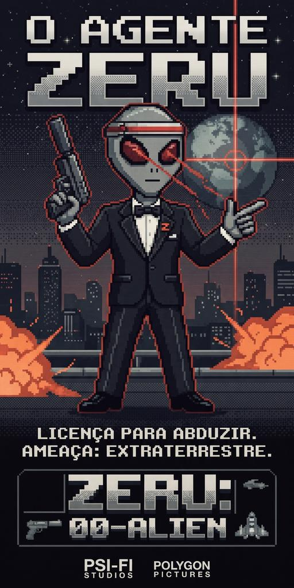

# Net Video Rental 2000

<p align="center">
  
</p>

<p align="center">
  <b>Uma autêntica locadora de fitas VHS dos anos 90 em 3D no navegador, com integração ao YouTube, TV de tubo CRT funcional e atmosfera de suspense retrô.</b>
</p>

<p align="center">
  <a href="LICENSE"></a>
  <a href="https://threejs.org/"></a>
  <a href="https://www.khronos.org/webgl/"></a>
  <a href="https://developer.mozilla.org/en-US/docs/Web/JavaScript"></a>
  <a href="https://developer.mozilla.org/en-US/docs/Web/API/Web_Audio_API"></a>
  <a href="src/i18n/"></a>
  <a href="CONTRIBUTING.md"></a>
  <a href="https://thiegocarvalho.github.io/net-video-rental-2000/"></a>
</p>

---

## 📼 Sinopse & Ambientação

*Outubro de 1999. A chuva fina bate contra o asfalto frio da calçada enquanto o letreiro em neon zune na fachada da **Net Video Rental 2000**. Ao empurrar a porta de vidro, o aroma de carpete antigo e o estalo estático da televisão de tubo transportam você diretamente de volta à era de ouro das locadoras de bairro.*

*Mas algo peculiar acontece nesta noite: as prateleiras de madeira não guardam apenas filmes comuns, mas sim vídeos reais do seu canal favorito do YouTube transformados em fitas VHS tangíveis. No balcão, um videocassete Hi-Fi VX-9000 aguarda para reproduzir as fitas com tracking e ruído analógico. No fundo, um computador com tela de fósforo verde roda o misterioso **RENTAL-OS** sob uma conexão discada de 9600 baud.*

*E, através da vitrine embaçada, uma silhueta suspeita observa silenciosamente cada passo seu a partir do estacionamento...*

---

## 🕹️ Funcionalidades Principais

- **Exploração em Primeira Pessoa (PS1 Aesthetic):** Gráficos poligonais estilizados, texturas nearest-neighbor com dither, iluminação pontual de baixa fidelidade e névoa volumétrica inspirados na era PlayStation 1 e Windows 95.
- **Transformação de Feed em Prateleiras VHS:** Insira o identificador de qualquer canal ou playlist do YouTube para gerar automaticamente um catálogo físico 3D com capas personalizadas geradas em tempo real em Canvas 2D.
- **Deck de Videocassete VX-9000 Funcional:** Coloque a fita no deck com física realista, controle avanço rápido, rebobinamento, ejeção e ajuste manual de tracking enquanto assiste ao vídeo na TV CRT do balcão.
- **Áudio 100% Procedural:** Toda a sonorização (passos, impactos, cliques mecânicos, motor do deck, estilhaços de vidro, sirene de alarme e ruídos de tensão) é gerada em tempo real via **Web Audio API** sem arquivos MP3/WAV pesados.
- **Fliperama Clássico no Gabinete:** Às sextas-feiras (ou via parâmetro `?arcade=on`), o gabinete de arcade da loja liga e permite jogar *The King of Fighters '97* emulado no navegador.
- **Terminal RENTAL-OS & Easter Eggs:** Comandos de linha de comando no computador do caixa, segredos desbloqueáveis, espingarda calibre 12, moedas de reciclagem, quebra-cabeças e 14 conquistas retro colecionáveis.

---

## 🛠️ Tecnologias Utilizadas

O projeto foi construído propositalmente com **arquitetura 100% client-side pura**, sem bundlers, sem transpilação pesada e sem dependências no servidor:

| Tecnologia | Finalidade no Projeto |
|---|---|
| **[Three.js](https://threejs.org/) (r128)** | Renderização da cena 3D, câmeras, malhas, materiais Lambert/Basic e raycasting de picking. |
| **WebGL 2.0 / WebGL 1.0** | Aceleração de hardware gráfico nativa diretamente no navegador. |
| **Vanilla ES Modules & Import Maps** | Modularidade limpa sem necessidade de Webpack, Vite ou etapa de compilação. |
| **Web Audio API** | Síntese de áudio procedural em tempo real com osciladores senoidais, ruído branco e filtros bi-quad. |
| **CSS3DRenderer** | Encaixe homográfico tridimensional de elementos HTML (player do YouTube e arcade) na geometria 3D. |
| **Canvas 2D API** | Geração dinâmica procedural das texturas das fitas VHS, post-its, relógio digital e cartazes. |
| **YouTube IFrame API** | Streaming e controle sincronizado de vídeos na tela CRT. |
| **LocalStorage API** | Caching resiliente de feeds RSS e persistência de conquistas e idioma. |

---

## 🚀 Como Executar Localmente

Como as texturas procedurais e os modelos 3D em formato `.glb` exigem políticas de CORS válidas, o projeto precisa ser servido através de um servidor HTTP local (não funciona abrindo `file://` diretamente):

```bash
# Inicie um servidor HTTP local em qualquer porta (ex.: 8080):
npx http-server -p 8080 -c-1
```

Em seguida, abra seu navegador em `http://localhost:8080/`.

Na tela inicial de boot, cole o link ou identificador de um canal ou playlist do YouTube e clique em **ENTRAR**.

### Parâmetros de URL Úteis (Deep Links)

Você pode pular a tela de entrada abrindo links diretos:

| Parâmetro | Descrição | Exemplo |
|---|---|---|
| `?c=` ou `?channel_id=` | Abre diretamente com o canal desejado | `http://localhost:8080/?c=UC_x5XG1OV2P6uZZ5FSM9Ttw` |
| `?playlist_id=` | Carrega uma playlist específica de fitas | `http://localhost:8080/?playlist_id=PLrAXtmErZgOdP...` |
| `?lang=` | Força o idioma da interface (`pt`, `en`, `es`) | `http://localhost:8080/?lang=en` |
| `?arcade=on` | Força o fliperama a ficar ligado em qualquer dia | `http://localhost:8080/?arcade=on` |
| `?debug` | Ativa contador de FPS e ferramentas de teste | `http://localhost:8080/?debug` |

---

## 🌐 Idiomas Suportados (i18n)

O jogo possui um sistema próprio de internacionalização nativo com dicionários modulares:
- 🇧🇷 **Português (Brasil)** — Idioma nativo/fonte
- 🇬🇧 **Inglês (Reino Unido)** — Dicionário completo
- 🇪🇸 **Espanhol (Espanha)** — Dicionário completo

O idioma é detectado automaticamente pelas preferências do navegador e pode ser alternado a qualquer instante pelos seletores **PT / EN / ES** na tela inicial ou na aba ESTOQUE do computador do caixa.

---

## 🎮 Controles

### Desktop (Teclado e Mouse)
- `W` `A` `S` `D` — Movimentar-se pela locadora
- `Mouse` — Olhar ao redor (cursor capturado via Pointer Lock)
- `E` — Interagir, pegar fitas, usar objetos e operar equipamentos
- `F` — Inspecionar e girar o item empunhado na mão
- `G` — Largar ou arremessar item
- `ESC` — Fechar terminais, modais ou soltar o cursor
- `M` — Alternar mudo do áudio ambiente
- **Controle Remoto da TV:** `W`/`Espaço` (Play/Pausa), `A` (Rebobina), `D` (Avança), `E` (Ejeta), `S`/`F` (Levanta do banquinho).

### Mobile / Touch (Celulares e Tablets)
- **Joystick Analógico (Canto inferior esquerdo):** Movimentação com sensibilidade radial.
- **Arrastar na Tela:** Rotação suave da câmera.
- **Toque Curto:** Interagir diretamente com o objeto sob o dedo.
- **Painel de Ações Rápidas (Canto inferior direito):** Botões táteis dedicados para USAR, VERIFICAR, LARGAR e ATIRAR.

---

## 📦 Modelos 3D & Atribuições de Licença

Todos os modelos 3D externos utilizados no jogo são disponibilizados sob licenças abertas permissivas (**CC0 1.0** ou **CC-BY 3.0**) e foram obtidos através do [Poly Pizza](https://poly.pizza/):

| Modelo 3D | Autor Original | Licença |
|---|---|---|
| **Arcade Machine** | J-Toastie | CC-BY 3.0 |
| **Jeep 4x4** | Alex Safayan | CC-BY 3.0 |
| **Animated Character** | J-Toastie | CC-BY 3.0 |
| **Desk Fan** | J-Toastie | CC-BY 3.0 |
| **Firework Rocket** | Josh Graham | CC-BY 3.0 |
| **Padlock** | Garrett LeFever | CC-BY 3.0 |
| **Piggy Bank** | Poly by Google | CC-BY 3.0 |
| **Desk Service Bell** | Jarlan Perez | CC-BY 3.0 |
| **Soda Can** | jeremy | CC-BY 3.0 |
| **Trash Can** | Zsky | CC-BY 3.0 |
| **Vending Machine** | dook | CC-BY 3.0 |
| **VHS Tape Basic** | S. Paul Michael | CC-BY 3.0 |
| **CRT Old TV** | Justin Randall | CC-BY 3.0 |
| **Retro Gateway Computer** | Charlie (creatureframe) | CC-BY 3.0 |
| **Roast Chicken** | Kenney | CC0 1.0 |
| **Coin** | Quaternius | CC0 1.0 |
| **Key** | Quaternius | CC0 1.0 |
| **Shotgun Pump West** | Pichuliru | CC0 1.0 |

Os textos completos de atribuição e links diretos estão preservados nos arquivos `.credits.txt` correspondentes na pasta `models/`.

---

## 🤝 Como Contribuir

Contribuições da comunidade são muito bem-vindas! Se você deseja sugerir uma melhoria, corrigir um bug ou adicionar novas traduções:

1. Leia o nosso [**Guia de Contribuição (CONTRIBUTING.md)**](CONTRIBUTING.md) e o [**Código de Conduta (CODE_OF_CONDUCT.md)**](CODE_OF_CONDUCT.md).
2. Faça um **Fork** do repositório.
3. Crie uma branch para a sua feature (`git checkout -b feature/minha-melhoria`).
4. Faça commits seguindo o padrão [Conventional Commits](https://www.conventionalcommits.org/) (`feat:`, `fix:`, `docs:`, `perf:`).
5. Certifique-se de que a validação de dicionários passa com sucesso:
   ```bash
   node tools/check-i18n.mjs
   ```
6. Abra um **Pull Request** detalhando as alterações propostas.

---

## 📄 Licença

O código-fonte do **Net Video Rental 2000** é distribuído sob a licença **[GNU General Public License v3.0 (GPLv3)](LICENSE)**.
Forks, modificações e distribuições derivadas devem permanecer sob a mesma licença livre de código aberto.
